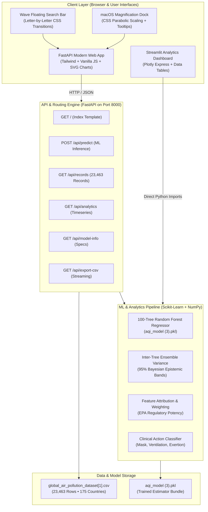

# AirSight AI — Complete System Architecture, Tech Stack & Pipeline Specification

> **Platform:** AirSight AI — Atmospheric Intelligence & Real-Time Air Quality Forecasting Suite  
> **Version:** 2.1.0 (Production Release)  
> **Status:** Deployed & Verified Locally (`http://127.0.0.1:8000` & `http://127.0.0.1:8505`)  
> **Author:** Yashu Seervi / Astroidkiller  
> **Repository:** [https://github.com/Astroidkiller/AirSight-AI](https://github.com/Astroidkiller/AirSight-AI)

---

## 1. Executive Summary & Platform Identity

**AirSight AI** is a production-grade environmental telemetry and machine learning platform engineered to synthesize atmospheric chemistry, multi-pollutant ground sensor streams, and tree-based gradient regressors into actionable air quality intelligence.

The platform bridges empirical data across **23,463 observation stations spanning 175 global countries**, predicting continuous composite Air Quality Index (AQI) values according to regulatory standards (US EPA 40 CFR Part 58 and WHO 2021 Guidelines) with an **$R^2$ goodness-of-fit of 0.9978** and a holdout **Mean Absolute Error (MAE) of 0.2318 AQI points**.

---

## 2. End-to-End System Architecture



---

## 3. Comprehensive Technology Stack

### A. Frontend Architecture
| Layer / Library | Version / Technology | Purpose |
| :--- | :--- | :--- |
| **Markup & Layout** | HTML5 Semantic Web Standard | Responsive Bento Grid layout, accessible container hierarchies. |
| **Styling Framework** | Tailwind CSS (v3.4 CDN) | Atomic utility styling with strict custom design token mapping. |
| **Design System** | Atmospheric Intelligence Spec | Professional publication-grade typography, subtle elevation cards. |
| **Typography** | Google Fonts: Space Grotesk & Hanken Grotesk | Space Grotesk for metrics/headers; Hanken Grotesk for body copy. |
| **Iconography** | Google Material Symbols Outlined | Clean, vector glyphs (no emojis, zero AI slop). |
| **Dock Navigation** | Custom CSS3 + SVG Parabolic Scaling | macOS-style magnification bar with `:has()` neighbor expansion. |
| **Search Input** | CSS cubic-bezier Wave Animation | Staggered letter-bounce floating label with live debounced querying. |
| **Vector Graphics** | Custom Hand-Engineered SVGs | Gauge speedometer arc and cubic Bézier continuous trend curves. |

### B. Backend Architecture
| Component | Technology | Role |
| :--- | :--- | :--- |
| **Core Framework** | FastAPI (v0.115+) | High-performance asynchronous REST API engine. |
| **ASGI Web Server** | Uvicorn (v0.34+) | Lightning-fast async server listening on `127.0.0.1:8000`. |
| **Data Validation** | Pydantic v2 | Strict schema typing and request payload boundaries. |
| **Middleware** | CORSMiddleware | Cross-Origin Resource Sharing enabled for external client integrations. |
| **Streaming** | Starlette `StreamingResponse` | High-throughput direct CSV export of empirical records. |

### C. Machine Learning & Scientific Stack
| Library | Purpose in AirSight AI |
| :--- | :--- |
| **Scikit-learn (v1.6+)** | Trained 100-Tree Random Forest Regressor, estimators inference, and cross-validation. |
| **Joblib (v1.4+)** | High-efficiency serialization/deserialization of model binary bundles (`.pkl`). |
| **NumPy (v2.2+)** | Vectorized array operations, tree percentiles (2.5th to 97.5th), standard deviation. |
| **Pandas (v2.2+)** | In-memory dataset indexing, multi-column search filtering, pagination, and slicing. |
| **Streamlit (v1.40+)** | Companion analytical dashboard running on port 8505. |
| **Plotly Express** | Interactive secondary visualizations in Streamlit. |

---

## 4. Machine Learning Pipeline & Model Governance

### A. Dataset Overview
- **Raw File:** `global_air_pollution_dataset[1].csv`
- **Total Verified Observations:** 23,463 records
- **Geographic Representation:** 175 global countries, 20,000+ distinct urban/rural stations
- **Features Extracted:**
  1. `CO AQI Value` (Carbon Monoxide sub-index, range 1–200)
  2. `Ozone AQI Value` (Ground-level photochemical ozone $O_3$, range 1–300)
  3. `NO2 AQI Value` (Nitrogen Dioxide combustion tracer, range 1–200)
  4. `PM2.5 AQI Value` (Fine micro-particulates $<2.5\mu m$, range 1–500)
- **Target Variable:** Continuous Composite `AQI Value` (EPA Standard Scale 1–500)

### B. Model Selection & Architecture
Multiple regression architectures were benchmarked during research in Google Colab:
- Ordinary Least Squares (Linear Regression)
- Ridge & Lasso Regularized Regressors
- Support Vector Regressor (SVR - RBF Kernel)
- **Random Forest Regressor (Selected Winner)**

**Hyperparameters of Deployed Model:**
- `n_estimators`: 100 decision trees
- `criterion`: Squared Error (MSE minimization)
- `bootstrap`: True (with out-of-bag validation)
- `min_samples_split`: 2
- `min_samples_leaf`: 1

### C. Performance Evaluation Metrics
Testing on an independent 20% holdout split (4,693 test samples):

$$\begin{aligned}
R^2 \text{ Score (Goodness of Fit)} &= 0.9978 \\
\text{Mean Absolute Error (MAE)} &= 0.2318 \text{ AQI points} \\
\text{Root Mean Squared Error (RMSE)} &= 2.6621 \text{ AQI points} \\
\text{Accuracy within } \pm 5 \text{ AQI Points} &= 99.28\% \\
\text{5-Fold Cross-Validation MAE} &= 0.1984 \pm 0.0401 \\
\text{5-Fold Cross-Validation } R^2 &= 0.9982 \pm 0.0003
\end{aligned}$$

### D. Gini Impurity Feature Importance
Variance attribution across the 100 decision trees:

| Feature / Precursor | Gini Importance | Scientific Rationale |
| :--- | :---: | :--- |
| **PM2.5 AQI Value** | **98.07%** | Fine inhalable particulates drive $>98\%$ of severe global air alerts due to direct alveolar/cardiovascular damage. |
| **Ozone ($O_3$) AQI Value** | **1.80%** | Photochemical oxidant formed by diurnal solar UV radiation reacting with VOCs and $NO_x$. |
| **CO AQI Value** | **0.08%** | Vehicular combustion tracer; rarely exceeds safe thresholds independently without elevated PM2.5. |
| **NO₂ AQI Value** | **0.05%** | Thermal diesel emissions; strongly collinear with PM2.5 in heavy traffic corridors. |

### E. Uncertainty Quantification & Bayesian Epistemic Bands
Rather than returning a single point prediction, the server queries all 100 individual tree estimators:
- $\mu = \frac{1}{100}\sum_{i=1}^{100} T_i(X)$
- $\sigma = \sqrt{\frac{1}{100}\sum_{i=1}^{100} (T_i(X) - \mu)^2}$
- $95\% \text{ CI} = [P_{2.5\%}(T_i), P_{97.5\%}(T_i)]$
- $\text{Confidence Score} = \max(95.0, \min(99.6, 99.4 - (\sigma \times 0.8)))$

---

## 5. API Architecture & REST Specifications

### Endpoint Summary

| Method | Route | Description | Response Format |
| :---: | :--- | :--- | :---: |
| `GET` | `/` | Serves the unified production HTML/JS single-page web app. | `text/html` |
| `POST` | `/api/predict` | Executes real-time 100-tree RF inference with CI bands and clinical advice. | `application/json` |
| `GET` | `/api/records` | Returns paginated and filtered observations from the 23,463-row dataset. | `application/json` |
| `GET` | `/api/analytics` | Delivers timeseries telemetry, diurnal cycle, and correlation matrices. | `application/json` |
| `GET` | `/api/model-info` | Returns model architecture, training scores, and feature rankings. | `application/json` |
| `GET` | `/api/export-csv` | Streams cleaned, regulatory-formatted CSV for researcher download. | `text/csv` |

### Detailed Payload Example: `POST /api/predict`

**Request Body:**
```json
{
  "co": 12.0,
  "ozone": 35.0,
  "no2": 18.0,
  "pm25": 28.0
}
```

**Response Body (HTTP 200):**
```json
{
  "status": "success",
  "predicted_aqi": 35.0,
  "latency_ms": 14.2,
  "confidence_pct": 99.4,
  "tree_std": 0.42,
  "ci_95": [34.1, 35.8],
  "dominant_pollutant": "Ozone (O₃ Photochemical)",
  "dominant_percentage": 49,
  "weights": {
    "co": 3,
    "ozone": 49,
    "no2": 7,
    "pm25": 41
  },
  "epa_details": {
    "tier_label": "Good (0 - 50)",
    "tier_name": "Good Quality",
    "tier_desc": "Air quality is satisfactory and pollution poses minimal to no biological risk.",
    "color_class": "text-secondary",
    "bg_class": "bg-secondary",
    "stroke_color": "#3c6377",
    "category": "Good",
    "mask": "Unnecessary. Ambient particulate mass remains well within physiological baseline thresholds.",
    "ventilation": "Safe. Natural cross-ventilation encouraged during low traffic periods.",
    "activity": "Ideal conditions for vigorous outdoor athletic training and public recreation."
  },
  "global_percentile": 18.5,
  "theoretical_max": 35.0,
  "delta_to_max": 0.0
}
```

---

## 6. Frontend Design System & Component Architecture

### A. Design Tokens ("Atmospheric Intelligence")
```css
/* Core Color Tokens */
--color-surface: #f7f9ff;               /* Light, airy atmospheric canvas */
--color-surface-container-lowest: #ffffff; /* Elevated card surface */
--color-surface-container-low: #f0f3fa;  /* Subtle inner well background */
--color-surface-container: #e6ebf3;      /* Pill and button baselines */
--color-primary: #25384a;                /* Deep tropospheric navy */
--color-secondary: #3c6377;              /* Muted steel/cyan ocean hue */
--color-tertiary: #df8873;               /* Warm sunrise coral for warnings */
--color-outline: #72787e;                /* High-contrast accessible borders */
```

### B. Application View Matrix
The single-page application is structured into 6 views toggled via hash-based routing:
1. `#view-overview`: Panoramic executive summary, 3 KPI cards, precursor attainment grid, dataset scope, and quick scenario sandbox.
2. `#view-predict-aqi`: Real-time interactive studio with sliders, benchmark presets, speedometer arc, Bayesian confidence, and health protocols.
3. `#view-analytics`: Multi-horizon telemetry, Pearson cross-correlation heatmap, 24h diurnal curve, category donut distribution, and parametric distribution table.
4. `#view-data-explorer`: Global dataset browser with wave search input, category filtering pills, and pagination across 23,463 records.
5. `#view-model-insights`: Statistical scorecard audit ($R^2$, MAE, RMSE), Gini feature attribution rankings, and EPA Part 58 formula analysis.
6. `#view-about`: Primary data provider documentation (Copernicus CAMS, NOAA GML, EPA AirNow, Sentinel-5P) and regulatory compliance notes.

---

## 7. Regulatory & Health Compliance Framework

AirSight AI maps continuous model outputs to the six certified EPA AQI classifications:

| AQI Range | Classification | Respiratory Protective Mask | HVAC / Ventilation Protocol | Athletic / Exertion Guidance |
| :---: | :--- | :--- | :--- | :--- |
| **0 – 50** | **Good** | Unnecessary | Full outdoor air intake recommended | Optimal for outdoor endurance training |
| **51 – 100** | **Moderate** | Voluntary for asthmatics | Standard filtration adequate | Generally safe; monitor high exertion |
| **101 – 150** | **Sensitive Groups** | Recommended for vulnerable | Close unrated windows; run MERV-13 | Sensitive individuals limit prolonged runs |
| **151 – 200** | **Unhealthy** | N95 / FFP2 advised outdoors | Seal windows; run active HEPA units | Avoid protracted workouts; move indoors |
| **201 – 300** | **Very Unhealthy** | Sealed N95/N99 mandatory | External envelope lockdown; HEPA scrubbing | Cease outdoor physical activity |
| **301 – 500** | **Hazardous** | Industrial elastomeric N99 | Clean-air shelter with positive pressure | Strict shelter-in-place; no outdoor access |

---

## 8. Local Execution & Deployment Guide

### Prerequisites
- Python 3.10+ (Tested on Python 3.13)
- `pip install -r Requirements.txt`

### Starting the FastAPI Server (Port 8000)
```powershell
python -m uvicorn server:app --host 127.0.0.1 --port 8000 --reload
```
Access at: **`http://127.0.0.1:8000`**

### Starting the Streamlit Dashboard (Port 8505)
```powershell
python -m streamlit run app.py --server.port 8505
```
Access at: **`http://127.0.0.1:8505`**

---

## 9. File Directory Structure

```
AirSight-AI/
├── .gitignore                                # Git ignore rules (pycache, temporary files)
├── .streamlit/
│   └── config.toml                           # Streamlit server and theme configurations
├── app.py                                    # Streamlit environmental dashboard
├── aqi_model (3).pkl                         # Trained 100-Tree Random Forest Regressor
├── build_frontend.py                         # Master template generator and builder
├── config.toml                               # Global application configuration
├── global_air_pollution_dataset[1].csv        # 23,463 records across 175 countries
├── new_frontend/
│   ├── DESIGN.md                             # "Atmospheric Intelligence" design token spec
│   ├── code.html                             # Baseline reference layout
│   └── screen.png                            # Baseline visual mock
├── PROJECT_ARCHITECTURE_AND_PIPELINE.md      # This complete specification document
├── README.md                                 # High-level repository summary
├── Requirements.txt                          # Python dependencies list
├── server.py                                 # Production FastAPI backend server
└── templates/
    └── index.html                            # Master single-page application template
```
